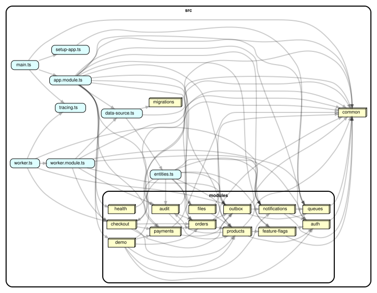

# patterns: 12 продакшн-патернів на одному магазині

Навчальний бекенд для фронтенд-розробника, який уже знає основи (контролери, сервіси, запити до бази) і хоче побачити, з чим стикається full-stack розробник середнього рівня у реальному продукті. Кожен модуль це не "урок", а конкретний кейс: що ламається, чому наївне рішення не працює, як зроблено правильно і який тест це доводить.

Домен: магазин. Tenants (кілька магазинів в одному сервісі), користувачі, товари (склад, ціна, версія), замовлення, платежі (фейковий провайдер), відправлення, зображення товарів, сповіщення, feature flags, audit log.

**Стек:** Node 22, TypeScript strict, NestJS 11, TypeORM 0.3 з міграціями, PostgreSQL 16, Redis 7 (ioredis), BullMQ, AWS SDK S3 (MinIO локально), class-validator, jest 30 + supertest, helmet, jsonwebtoken, bcryptjs, opossum. Довідка API на Scalar (`/reference`), Bull Board (`/queues`).

Один застосунок, одна база, один Redis, окремий worker-процес. Без монорепо і без шарів DDD: `src/modules/<name>/` з controller, service, entity, dto і `src/common/` для спільного.

## Запуск

Потрібні Node 22 і запущений Docker Desktop.

```
npm run up
```

Далі відкрити:

- http://localhost:3002/reference: контракт API
- http://localhost:3002/queues: черги, email і dead-letter
- http://localhost:3002/scheme: схема проєкту
- http://localhost:9001: MinIO, minioadmin / minioadmin

Зупинити: `npm run down`. Разом з даними: `npm run down -- --wipe`.

<details>
<summary>Що робить npm run up і що робити, якщо щось пішло не так</summary>

Ставить npm-залежності, якщо їх немає, створює `.env`, гасить інший проєкт `backend-*`, якщо він зараз працює (усі три ділять порти 5432, 6379, 16686), піднімає все через docker compose, чекає, поки сервіси стануть healthy, робить перевірочні запити і друкує адреси.

Якщо порт зайнятий чимось поза Docker (локальний Postgres або Redis), скрипт бере наступний вільний, записує його в `.env` (наприклад `PG_PORT=5433`) і друкує справжні адреси. Щоб повернути типові порти, видали ці рядки з `.env`. Якщо якийсь сервіс упав, скрипт надрукує його логи; повний лог: `docker compose logs <сервіс>`.

</details>

## Карта залежностей



Кожен вузол це каталог `src/modules/<name>` (або `src/common`, або окремий файл верхнього рівня), стрілка `A -> B` означає "файли з A імпортують щось із B": `common` має найбільше вхідних стрілок, бо це спільна основа, за ним `products`, `outbox` і `orders`, бо на їхні entity і сервіси спираються інші модулі, `main.ts` і `worker.ts` мають лише вихідні, бо це точки входу. Повний граф по файлах: [docs/graphs/files.svg](docs/graphs/files.svg); перегенерувати обидва: `npm run graph` і `npm run graph:files` (потрібен Graphviz, команда `dot` у PATH); перевірити правила (без циклів, крім пар entity у TypeORM, і `src` не імпортує `test`): `npm run deps:check`.

Довідка по коду (Compodoc): `npm run docs:code`, потім відкрити `docs/compodoc/index.html` у браузері. Сторінка "Modules" показує для кожного Nest-модуля його controllers, providers і imports, тобто те, що `@Module({...})` збирає докупи, і з чого складається граф вище.

## Як це влаштовано

```
браузер
   |  JWT Bearer
   v
API (src/main.ts)                          worker (src/worker.ts)
  auth, products, orders, checkout,          OutboxRelay      (outbox -> черга events)
  payments/webhook, files, flags,            EventsConsumer   (events -> consumed_events, лист у чергу)
  audit, notifications, demo                 EmailWorker      (notifications -> sent_emails, DLQ)
   |            |                            SagaResumer      (зависла саґа -> доробити)
   v            v                                |
PostgreSQL 16   Redis 7 (кеш прапорців, BullMQ)  |   MinIO / S3 (зображення, напряму з браузера)
   ^____________________________________________|
```

Auth навмисно мінімальний: `POST /auth/register` (перший користувач нового tenant стає admin), `POST /auth/login`, `GET /auth/me`, ролі `user` і `admin`. Він не предмет проєкту.

## Схема і PDF

- `docs/architecture.excalidraw`: схема проєкту. Після `npm run up` вона відкривається на `/scheme` прямо з API; редагувати можна на excalidraw.com.
- `docs/Backend_without_panic.pdf`: короткий документ на всі три проєкти: для кожної теми що це, чому важливо, коли про це думати, коли можна забити, при якому трафіку і як зрозуміти, що час настав.

## Змінні середовища

Усі описані в `.env.example`. Головні:

| Змінна | Що | Типово |
| --- | --- | --- |
| `PORT` | порт API | `3002` |
| `JWT_SECRET` | секрет JWT | `dev-secret-change-me` |
| `PAYMENT_WEBHOOK_SECRET` | секрет HMAC вебхука | `whsec-dev` |
| `DB_HOST`, `DB_PORT`, `DB_USER`, `DB_PASSWORD`, `DB_NAME` | PostgreSQL | `localhost:5432`, `patterns` |
| `DB_LOGGING` | друкувати SQL (profiling) | `false` |
| `REDIS_HOST`, `REDIS_PORT`, `REDIS_DB` | Redis | `localhost:6379`, db `0` |
| `STORAGE_DRIVER` | `s3` або `fake` | `s3` |
| `S3_ENDPOINT`, `S3_REGION`, `S3_BUCKET`, `S3_ACCESS_KEY_ID`, `S3_SECRET_ACCESS_KEY`, `S3_FORCE_PATH_STYLE` | сховище (MinIO або AWS) | MinIO локально |
| `MAX_IMAGE_BYTES` | ліміт зображення | `2097152` |
| `BREAKER_IMPL` | `opossum` або `custom` | `opossum` |
| `BREAKER_FAILURE_THRESHOLD`, `BREAKER_WINDOW_MS`, `BREAKER_RESET_MS`, `BREAKER_CALL_TIMEOUT_MS` | параметри breaker | 5 / 10000 / 30000 / 2000 |
| `FLAGS_CACHE_TTL_SEC` | кеш прапорців | `10` |
| `EMAIL_ATTEMPTS`, `EMAIL_BACKOFF_MS` | retry листів | 3 / 1000 |
| `OUTBOX_POLL_MS`, `OUTBOX_BATCH_SIZE` | relay | 1000 / 50 |
| `SAGA_RESUME_AFTER_MS`, `SAGA_RESUME_POLL_MS` | resumer саґ | 30000 / 5000 |
| `OTEL_EXPORTER_OTLP_ENDPOINT`, `OTEL_SERVICE_NAME` | трейсинг у Jaeger, порожньо = вимкнено | порожньо (у compose `http://jaeger:4318`) |

## Тести

```bash
npm run lint       # eslint
npm run build      # tsc
npm test           # unit: 11 тестів (breaker, rollout, підпис вебхука), без бази
npm run test:e2e   # e2e: 47 тестів, 11 suites, потрібні Postgres і Redis
```

E2E читають `TEST_DB_HOST`, `TEST_DB_PORT`, `TEST_REDIS_HOST`, `TEST_REDIS_PORT` (типово localhost, 5432, 6379), база `patterns_test`, Redis db `1`. Міграції виконуються в `globalSetup`. Кожен suite створює свій tenant, тому базу між прогонами чистити не треба.

Один suite: `npx jest --config jest.e2e.config.js --runInBand test/e2e/saga`.

## Скрипти

| Команда | Що |
| --- | --- |
| `npm run dev`, `npm run dev:worker` | API і worker з ts-node |
| `npm run start`, `npm run start:worker` | те саме з `dist` після `npm run build` |
| `npm run migration:run`, `npm run migration:revert` | міграції TypeORM |
| `npm run seed` | тестові дані |
| `./scripts/smoke.sh` | curl-прохід по модулях проти запущеного API і worker |
| `npm run graph`, `npm run graph:files`, `npm run deps:check` | граф модулів і файлів у `docs/graphs/`, перевірка правил імпортів (dependency-cruiser) |
| `npm run docs:code` | довідка по коду у `docs/compodoc/` (Compodoc, не комітиться) |
